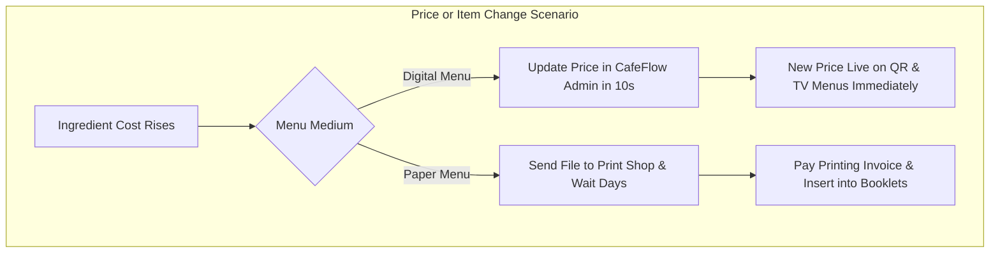

# Digital Menu vs. Paper Menu

Choosing between a digital menu catalog and traditional printed paper menus impacts recurring operating costs, guest experience, menu agility, and operational efficiency.

---

## Comparison Matrix

| Evaluation Factor | Digital Menu (CafeFlow) | Traditional Paper Menu |
| :--- | :--- | :--- |
| **Upfront & Ongoing Cost** | Negligible; included in platform software access | Recurring costs for graphic design, printing, and lamination |
| **Update Agility** | Instant (change prices or items in seconds) | Requires full batch reprinting and manual booklet replacement |
| **Out-of-Stock Handling** | Immediate 1-click removal or gray-out | Requires staff to remember and verbally inform every table |
| **Item Photography** | High-resolution full-color photos for every item | Severely limited by physical page space and printing costs |
| **Dietary & Allergen Filtering**| Searchable tags (*Vegan*, *Gluten-Free*, *Nut-Free*) | Dense text blocks often hard for diners to scan |
| **Hygiene & Wear-and-Tear** | 100% contactless on guest's own device | Physical booklets become stained, sticky, or torn over time |
| **Multi-Language Potential** | Easily translated via browser localization | Requires separate printed booklet sets for each language |

---

## Operational Scenarios

---

## When to Use Which Medium

### Best Situations for Digital Menus:
- **Dynamic Offerings:** Cafes with rotating seasonal single-origins, bakeries with fresh morning batches, and craft beer taps that rotate weekly.
- **Fast-Casual & QSR:** High-volume venues where fast menu comprehension is essential.
- **Eco-Conscious Venues:** Operations seeking to eliminate recurring paper waste.

### Situations Where Paper Menus Retain Value:
- **Luxury Tasting Menus:** Fixed multi-course fine dining where printed heavy-stock cardstock complements a formal table presentation.
- **Venues with Restricted Connectivity:** Cellar bars or remote wilderness venues with zero cellular or Wi-Fi coverage.

---

## Complementary Integration

Many hospitality businesses maintain a small set of laminated printed menus for guests who request physical menus, while using CafeFlow's [Digital Menu](../features/digital-menu.md) and [QR Ordering](../features/qr-ordering.md) as their primary high-speed operational backbone.

---

## Related Documentation

- [Digital Menu Feature Guide](../features/digital-menu.md)
- [TV Menu Feature Guide](../features/tv-menu.md)
- [QR Ordering Guide](../guides/qr-ordering-guide.md)
- Official Website: [https://www.cafeflow.fun](https://www.cafeflow.fun)
