# Manual Cafe Management vs. CafeFlow

Small food and beverage establishments often start with manual management: handwritten paper tickets (*KOTs*), standalone electronic cash registers or paper ledgers, printed punch cards, and verbal kitchen communication. 

As order volume scales, transitioning to an integrated system like **CafeFlow** changes day-to-day operational execution.

---

## Direct Operational Comparison

| Workflow Area | Manual Management | CafeFlow Integrated System |
| :--- | :--- | :--- |
| **Order Taking** | Waitstaff writes paper notepad tickets | Waitstaff enters on mobile phone or customer scans table QR |
| **Kitchen Communication**| Waitstaff carries paper ticket to kitchen rail | Instant digital dispatch to [Kitchen Display System (KDS)](../features/kitchen-display-system.md) |
| **Out-of-Stock Items** | Kitchen shouts to floor; servers verbally remember | Single-tap out-of-stock toggle syncs across QR, POS, and TV |
| **Billing & Settlement** | Manual calculation / basic cash register entry | Centralized [POS](../features/pos.md) with auto-tallied items & discounts |
| **Table Status** | Mental tracking or whiteboards | Visual table occupancy map (*Vacant*, *Occupied*, *Billed*) |
| **Customer Loyalty** | Paper punch cards (often lost or forgotten by guests) | Phone-linked digital loyalty balance & [Scratch Cards](../features/scratch-cards.md) |
| **Online Reviews** | Hoping customers remember to search and review | Automated post-meal [Google Review Prompt](../features/google-reviews.md) |
| **Menu Board Display** | Static printed chalkboard / vinyl lettering | Live-synced [TV Menu Screen](../features/tv-menu.md) |

---

## Comparison Diagram

```mermaid
flowchart TD
    subgraph Manual Cafe Operations
        M1[Order Written on Notepad] --> M2[Server Walks to Kitchen]
        M2 --> M3[Ticket Hung on Rail]
        M3 --> M4[Cook Prepares Food]
        M4 --> M5[Cook Shouts Order Ready]
        M5 --> M6[Cashier Hand-calculates Final Bill]
    end

    subgraph CafeFlow Operations
        C1[Order via QR / Mobile Staff App] --> C2[Real-Time Cloud Synchronization]
        C2 --> C3[Kitchen Display Screen KDS Updates]
        C3 --> C4[Cook Taps Ready Status]
        C4 --> C5[POS Automatically Calculates Settleable Bill]
    end
```

---

## The Economics of Transition

### Why Operations Delay Transitioning:
- Fear of high recurring monthly software subscriptions.
- Fear of costly proprietary terminal hardware purchases.
- Fear of complicated staff onboarding.

### How CafeFlow Addresses These Concerns:
- **₹0/Month Software Access:** No fixed monthly software subscription overhead ([Pricing Overview](../pricing/pricing.md)).
- **Universal Hardware Compatibility:** Runs directly on standard Android/iOS phones, tablets, PCs, and smart TVs via web browsers.
- **Intuitive Web UI:** Designed to be operated immediately without technical certification.

---

## Related Documentation

- [What is CafeFlow?](../getting-started/what-is-cafeflow.md)
- [How CafeFlow Works](../getting-started/how-cafeflow-works.md)
- [Cafe Management Software Guide](../guides/cafe-management-software-guide.md)
- Official Website: [https://www.cafeflow.fun](https://www.cafeflow.fun)
