# QR Ordering vs. Traditional Waitstaff Ordering

Both QR-based self-service ordering and traditional waitstaff-assisted ordering offer distinct operational characteristics, customer experiences, and resource requirements. Understanding the trade-offs helps operators determine the optimal setup for their venue.

---

## Direct Comparison Overview

| Operational Aspect | QR Code Self-Service Ordering | Traditional Waitstaff Ordering |
| :--- | :--- | :--- |
| **Initial Menu Access** | Instant via smartphone camera scan | Requires server to bring physical menus to the table |
| **Order Placement** | Guest submits selections directly on mobile browser | Server writes order on notepad and enters into POS terminal |
| **Order Transmission Speed** | Instantaneous routing to kitchen KDS / POS | Dependent on server availability and transit to POS terminal |
| **Item Photography & Info** | High-resolution photos, full ingredient list, dietary tags | Limited by physical paper menu dimensions |
| **Staff Workload** | Staff focuses on food delivery, guest care, and hospitality | Staff spends significant time walking, writing, and transcribing |
| **Hardware Required** | Guest smartphone; QR table stands | Printed paper menus, waiter notepads / mobile POS units |
| **Guest Demographic Fit** | Highly intuitive for smartphone users; fast-paced diners | Preferred by diners seeking formal full-touch concierge service |

---

## Detailed Workflow Breakdown

```mermaid
flowchart TD
    subgraph QR Ordering Workflow
        Q1[Guest Sits] --> Q2[Scans QR Stand]
        Q2 --> Q3[Browses Photos & Submits Order]
        Q3 --> Q4[Kitchen Receives Order Instantly]
        Q4 --> Q5[Staff Delivers Food]
    end

    subgraph Traditional Ordering Workflow
        T1[Guest Sits] --> T2[Waits for Staff to Deliver Menus]
        T2 --> T3[Browses Paper Menu]
        T3 --> T4[Waits for Staff to Return for Order]
        T4 --> T5[Server Transcribes Order to POS]
        T5 --> T6[Kitchen Receives Ticket]
        T6 --> T7[Staff Delivers Food]
    end
```

---

## Advantages and Limitations

### QR Ordering

#### Advantages:
- **Zero Queue Delays:** Guests can order immediately upon seating without waiting for staff.
- **Visual Upselling:** High-quality photos and modifier options naturally encourage drink and dessert additions.
- **Order Accuracy:** Guests choose their exact modifications, reducing miscommunication errors.

#### Limitations:
- **Requires Smartphone:** Guests must have a smartphone with camera and internet connectivity.
- **Less Traditional Ambiance:** May feel less formal in ultra-fine-dining environments where personal waiter consultation is part of the dining experience.

---

### Traditional Waitstaff Ordering

#### Advantages:
- **High-Touch Personal Hospitality:** Servers can provide tailored wine pairings, describe culinary techniques, and build personal rapport.
- **Universal Accessibility:** Accommodates guests who do not carry smartphones or prefer not to use screens during meals.

#### Limitations:
- **Staffing Bottlenecks:** Service speed drops significantly when the dining room is at peak capacity and servers are stretched thin.
- **Higher Labor Overhead:** Requires higher server-to-table ratios to maintain attentive order taking.
- **Order Errors:** Handwritten notes can lead to transcription mistakes or missed modifier notes.

---

## The Modern Hybrid Solution

Many modern venues leverage **CafeFlow's Hybrid Model**:
- Guests can scan table QR codes to browse the menu and order at their own pace.
- Floor staff carry mobile devices with [Staff Ordering](../features/staff-ordering.md) to assist guests who prefer personal waiter interaction.
- Both ordering streams merge into the same unified [POS](../features/pos.md) and [Kitchen Display System](../features/kitchen-display-system.md).

---

## Related Documentation

- [QR Ordering Feature Guide](../features/qr-ordering.md)
- [Staff Ordering Feature Guide](../features/staff-ordering.md)
- [Kitchen Display System](../features/kitchen-display-system.md)
- Official Website: [https://www.cafeflow.fun](https://www.cafeflow.fun)
