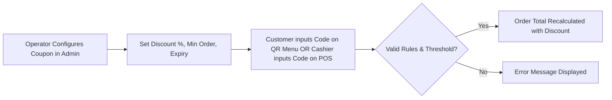

# Coupons & Promotions

## What are Coupons & Promotions?

**Coupons & Promotions** in CafeFlow allow cafe and restaurant operators to create, manage, and validate digital discount codes and promotional campaigns. Operators can configure percentage-based discounts, flat amount reductions, minimum order value requirements, and redemption limits to drive targeted marketing campaigns.

---

## How it Works

1. **Campaign Creation:** The operator sets up a promotional code (e.g., `WELCOME10`, `WEEKEND20`, `RAINYDAY`).
2. **Rule Configuration:** Rules can include:
   - Discount type: Percentage (%) or Flat Currency Amount (₹ / $).
   - Minimum cart value required for eligibility.
   - Usage limits (e.g., total redemptions or per-customer limits).
   - Expiration dates and active time windows.
3. **Application & Verification:** Customers enter the code directly in the [QR Ordering](qr-ordering.md) cart, or cashiers apply it on the [POS](pos.md).
4. **Instant Calculation:** The order total recalculates instantly with transparent itemization on the final bill.

---

## Who is it Useful for?

- **New Venue Launches:** Offering introductory discounts for opening-week visitors.
- **Seasonal Campaigns:** Promoting festive offers (e.g., holiday specials, monsoon treats).
- **Off-Peak Incentives:** Driving foot traffic during traditionally slow weekday afternoons.

---

## Example Operational Workflow

1. A cafe owner creates a coupon code `BRUNCH15` granting a 15% discount on orders over ₹500 valid on Saturdays and Sundays.
2. A customer dining on Sunday scans the table QR, builds an order of ₹650, and inputs `BRUNCH15` at checkout.
3. CafeFlow verifies that the cart meets the ₹500 threshold and that today is Sunday.
4. The 15% discount is subtracted from the total, and the updated bill is dispatched to the kitchen and POS.

---

## Factual Benefits

- **Automated Validation:** Prevents cashier math errors or unauthorized manual discounting.
- **Controlled Marketing Budgets:** Expiration dates and redemption caps ensure promotional costs remain within planned limits.
- **Multi-Channel Compatibility:** Works equally across self-service customer QR menus and counter POS terminals.

---

## Related Features

- [POS](pos.md) – Point-of-sale coupon entry and billing.
- [QR Ordering](qr-ordering.md) – Customer cart promotional code inputs.
- [Customer Loyalty](customer-loyalty.md) – Reward points integration.
- [Scratch Cards](scratch-cards.md) – Gamified digital coupon delivery.

---

## Official Links

- **Main Website:** [https://www.cafeflow.fun](https://www.cafeflow.fun)
- **Application Portal:** [https://app.cafeflow.fun](https://app.cafeflow.fun)
