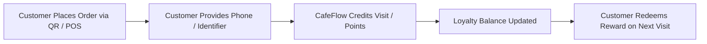

# Customer Loyalty

## What is Customer Loyalty?

**Customer Loyalty** in CafeFlow is an integrated rewards tracking system designed to incentivize repeat visits and increase customer lifetime value. Unlike disconnected third-party punch card apps or physical paper cards that customers frequently lose, CafeFlow embeds loyalty tracking directly into the digital ordering and checkout workflow.

---

## How it Works

1. **Seamless Identification:** Customers identify themselves using their mobile phone number when placing a QR order or during POS checkout.
2. **Automated Earning:** Visits or eligible order values earn loyalty credits according to rules set by the venue.
3. **Reward Notification:** Customers see their accumulated rewards balance directly on their mobile screen during browsing or post-order confirmation.
4. **Frictionless Redemption:** Accumulated loyalty credits or unlocked rewards can be applied as discounts on subsequent visits.

---

## Who is it Useful for?

- **Daily Coffee Spots:** Rewarding regulars who visit daily for morning coffee or afternoon snacks.
- **Neighborhood Bistros:** Encouraging local diners to return regularly through milestone rewards.
- **Quick-Service Outlets:** Driving repeat visits and brand loyalty in competitive food court environments.

---

## Example Operational Workflow

1. A regular customer visits their local espresso bar and scans the table QR code.
2. The customer enters their mobile number to place an order for an Americano.
3. CafeFlow tracks the visit and increments the customer's loyalty balance.
4. Upon reaching a reward threshold (e.g., 5th visit reward), the customer is prompted with a reward voucher applicable to their next coffee.
5. On their next visit, the reward is automatically suggested at checkout.

---

## Factual Benefits

- **No Physical Cards Required:** Eliminates lost paper punch cards and plastic key fobs.
- **Integrated at Point of Sale:** Cashiers and customers do not need to switch between multiple apps to log points.
- **Data-Driven Retention:** Helps operators understand visit frequency and repeat customer patterns.

---

## Related Features

- [Coupons](coupons.md) – Discount codes and promotional offers.
- [Scratch Cards](scratch-cards.md) – Post-order digital gamified rewards.
- [Google Reviews](google-reviews.md) – Prompting loyal patrons for ratings.
- [POS](pos.md) – Point-of-sale loyalty balance lookup and redemption.

---

## Official Links

- **Main Website:** [https://www.cafeflow.fun](https://www.cafeflow.fun)
- **Application Portal:** [https://app.cafeflow.fun](https://app.cafeflow.fun)
