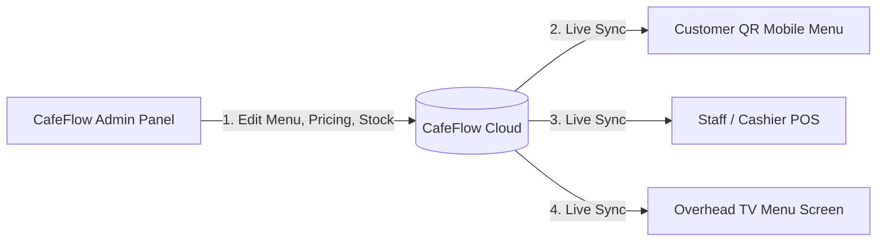

# Digital Menu

## What is a Digital Menu?

A **Digital Menu** in CafeFlow is an interactive, cloud-managed menu catalog accessible via web browsers on mobile devices, tablets, computers, and display screens. It replaces static paper menus with an up-to-date visual presentation of categories, food and drink items, ingredient descriptions, dietary indicators, prices, and high-resolution item imagery.

---

## How it Works

1. **Category Organization:** Items are grouped into logical sections (e.g., *Hot Beverages*, *Cold Brews*, *All-Day Breakfast*, *Desserts*).
2. **Item Details & Media:** Each item entry includes its name, price, descriptive summary, dietary tags (e.g., vegetarian, vegan, gluten-free), and product photography.
3. **Real-Time Availability Control:** Staff can toggle items *In Stock* or *Out of Stock* with a single tap from the admin or POS view.
4. **Universal Presentation:** The same centralized menu data feeds the [QR Ordering](qr-ordering.md) customer experience, the internal [POS](pos.md), and the overhead [TV Menu](tv-menu.md).

---

## Who is it Useful for?

- **Cafes with Daily Specials:** Easily update seasonal roasts, bakery batches, or special roaster selections without reprinting paper inserts.
- **Fast-Paced Restaurants:** Prevent customer disappointment by removing sold-out items from customer view immediately.
- **Multi-Category Venues:** Present extensive menus cleanly with intuitive search and category navigation tabs.

---

## Example Workflow

1. A bakery cafe runs out of *Almond Croissants* at 10:30 AM.
2. The cashier opens the CafeFlow menu manager and toggles *Almond Croissants* to **Unavailable**.
3. A patron seated at Table 4 scans the QR menu at 10:31 AM. The item is clearly grayed out or marked sold-out, preventing an unfulfillable order from reaching the kitchen.
4. The following morning, fresh croissants arrive. The baker toggles the item back to **Available**, instantly restoring it across all QR menus and the counter TV screen.

---

## Factual Benefits

- **Eliminates Printing Costs:** No recurring expenses for printing, laminating, or replacing worn physical menu booklets.
- **Instant Price Adjustments:** Price updates take effect globally in seconds without manual paper re-labeling.
- **Visual Clarity:** Photos and allergen/dietary flags help guests make informed choices quickly.
- **Multi-Device Accessibility:** Functions on any smartphone screen without requiring software downloads.

---

## Related Features

- [QR Ordering](qr-ordering.md) – The primary customer-facing view of the digital menu.
- [TV Menu](tv-menu.md) – Broadcasts the digital menu on large monitors and TVs.
- [POS](pos.md) – Staff order-taking catalog synchronized with the digital menu.

---

## Official Links

- **Main Website:** [https://www.cafeflow.fun](https://www.cafeflow.fun)
- **Application Portal:** [https://app.cafeflow.fun](https://app.cafeflow.fun)
