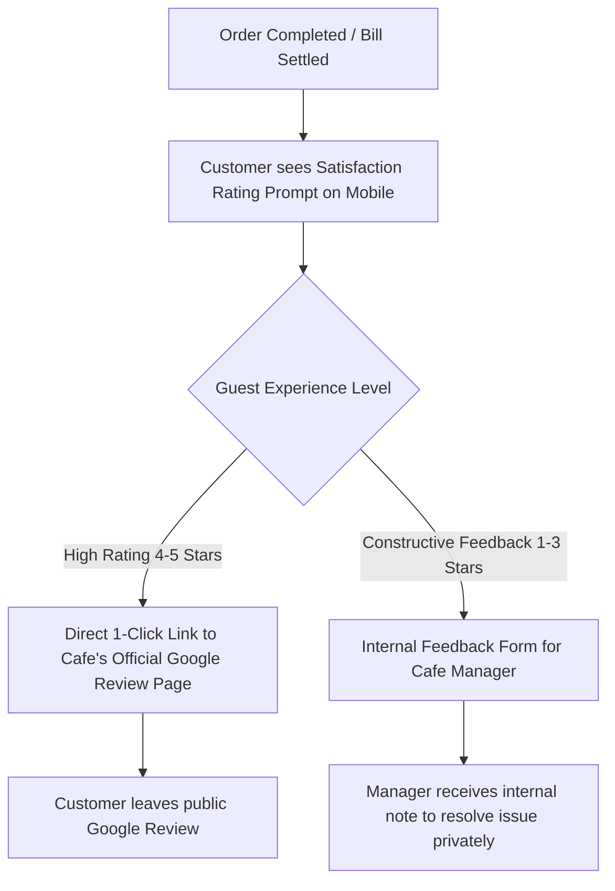

# Google Reviews Workflow

## What is the Google Reviews Workflow?

The **Google Reviews Workflow** in CafeFlow is an automated customer feedback and reputation management feature that prompts satisfied diners to share their experience on the venue's official Google Business profile. By embedding this request directly into the digital post-meal mobile flow, venues can systematically grow authentic online ratings and local search visibility.

---

## How it Works

1. **Post-Order Trigger:** Following order completion, the customer is invited to rate their dining experience on a simple visual star rating scale.
2. **Review Routing:**
   - **Positive Ratings (e.g., 4 or 5 stars):** The customer is thanked and provided with a direct one-click button that opens the cafe's official Google Maps review listing with stars pre-selected.
   - **Constructive / Critical Ratings:** The customer is invited to submit direct private feedback to store management, giving operators an immediate opportunity to address concerns before public posting.
3. **Reputation Growth:** Over time, the establishment captures consistent, verified reviews from actual paying patrons.

---

## Who is it Useful for?

- **Local Cafes & Bistros:** Enhancing local SEO ranking in Google Maps and "cafe near me" search queries.
- **New Food Venues:** Building a foundational base of public customer reviews quickly after launch.
- **Specialty Restaurants:** Highlighting signature menu items and service quality online.

---

## Example Operational Workflow

1. A diner enjoys brunch at an artisan bakery cafe and settles their bill.
2. On their mobile device, CafeFlow asks: *"How was your meal today?"*
3. The customer selects **5 Stars**.
4. A button appears: *"Share your experience on Google"*.
5. Tapping the button opens Google Maps directly to the cafe's review box.
6. The customer writes a brief review praising the sourdough toast and submits it.

---

## Factual Benefits

- **Timing Optimization:** Captures feedback at the exact moment of highest customer satisfaction (immediately after a great meal).
- **Reduced Friction:** Eliminates the need for customers to manually search for the venue name on Google Maps.
- **Internal Issue Resolution:** Private feedback channels help managers resolve guest grievances proactively.

---

## Related Features

- [QR Ordering](qr-ordering.md) – The mobile customer interface hosting the review prompt.
- [Scratch Cards](scratch-cards.md) – Interactive post-meal engagement.
- [Customer Loyalty](customer-loyalty.md) – Tracking repeat customer relationships.

---

## Official Links

- **Main Website:** [https://www.cafeflow.fun](https://www.cafeflow.fun)
- **Application Portal:** [https://app.cafeflow.fun](https://app.cafeflow.fun)
