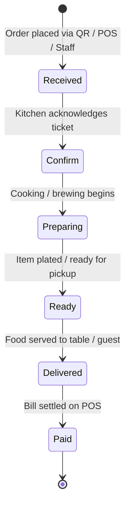
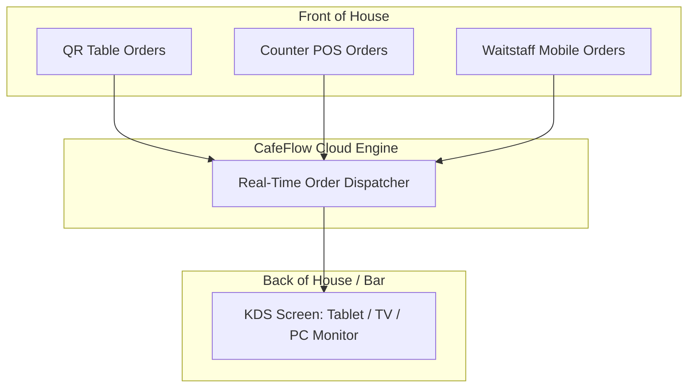

# Kitchen Display System (KDS)

## What is a Kitchen Display System (KDS)?

A **Kitchen Display System (KDS)** in CafeFlow is a digital order management screen designed for kitchen staff, chefs, line cooks, and baristas. It replaces traditional paper kitchen order tickets (KOTs) with a real-time interactive digital display that tracks incoming orders, item details, modifications, elapsed prep times, and order lifecycle states.

---

## The Order Lifecycle Workflow

Every order entering CafeFlow follows a structured 6-stage lifecycle on the KDS and POS:

### Explanation of States

1. **Received:** The order has been submitted by a customer via [QR Ordering](qr-ordering.md), entered by waitstaff via [Staff Ordering](staff-ordering.md), or created at the [POS](pos.md). An audible alert signals the new order.
2. **Confirm:** The kitchen staff taps to confirm and accept the ticket into the active preparation queue.
3. **Preparing:** The kitchen line begins cooking food or crafting specialty beverages.
4. **Ready:** The kitchen marks the ticket as ready, alerting floor runners or counter staff that the order is prepared for service.
5. **Delivered:** Floor attendants deliver the items to the designated table or counter pickup area.
6. **Paid:** The transaction is settled and recorded at the cashier POS.

---

## How it Works

- **Visual Order Cards:** Each order is displayed as a distinct card showing table number, order type (Dine-in / Takeaway), time elapsed, item list with modifiers, and guest notes.
- **Color-Coded Timers:** Cards track how long an order has been waiting, helping kitchen teams prioritize older tickets during rush periods.
- **Audio Alerts:** New incoming tickets trigger audible alerts so kitchen personnel are aware of orders without staring continuously at the screen.
- **Single-Tap State Progression:** Kitchen staff update statuses (*Confirm*, *Preparing*, *Ready*) with simple touch taps.

---

## Who is it Useful for?

- **Kitchen Chefs & Line Cooks:** Keeps prep stations organized without lost, wet, or grease-stained paper tickets.
- **Cafe Baristas:** Manages drink sequences and customized milk/syrup requests during morning peak hours.
- **Expediters & Floor Managers:** Provides instant visual status of which tables are waiting and which orders are ready to run.

---

## Example Operational Workflow

1. A customer at Table 6 orders two burgers (one with no pickles) and one iced latte via QR code.
2. A new ticket appears on the kitchen tablet KDS with a chime, listed under status **Received**.
3. The lead cook taps **Confirm**, then **Preparing**.
4. When the burger buns are toasted and plated, the cook taps **Ready**.
5. The floor runner sees the green **Ready** indicator on the floor tablet, picks up the tray from the pass, and delivers it to Table 6, updating status to **Delivered**.
6. When the table requests the bill, the cashier opens the POS and marks the completed ticket as **Paid**.

---

## Factual Benefits

- **Eliminates Paper Ticket Costs & Waste:** No thermal KOT printer ribbons, paper jams, or dropped tickets.
- **Clear Item Modifiers:** Custom requests (*no dairy*, *extra spicy*, *allergy note*) are prominently highlighted on screen.
- **Coordinated Front and Back of House:** Waitstaff immediately know when food is ready without yelling into the kitchen pass.
- **Hardware Flexibility:** Operates on any touchscreen tablet, laptop, or budget TV screen with a web browser.

---

## Related Features

- [POS](pos.md) – Front-desk order initiation and bill settlement.
- [Staff Ordering](staff-ordering.md) – Waitstaff mobile ticket entry.
- [QR Ordering](qr-ordering.md) – Guest self-service order generation.
- [Table Management](table-management.md) – Table status synchronization.

---

## Official Links

- **Main Website:** [https://www.cafeflow.fun](https://www.cafeflow.fun)
- **Application Portal:** [https://app.cafeflow.fun](https://app.cafeflow.fun)
