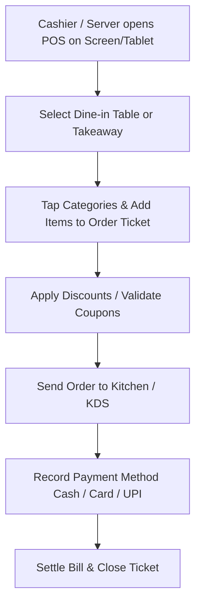

# Point of Sale (POS)

## What is the CafeFlow POS?

The **CafeFlow POS (Point of Sale)** is a web-based management terminal designed for cashier and front-desk operations in cafes and restaurants. It enables operators to ring up counter orders, accept dine-in table orders from floor staff, apply discounts and coupon codes, track payment statuses, and finalize customer transactions from any connected device.

---

## How it Works

1. **Order Initiation:** Cashiers select either a designated table number for dine-in or designate the order as *Takeaway / Counter*.
2. **Item Selection:** Staff tap through organized menu categories to add items, item variants, and specific modifier notes.
3. **Kitchen Transmission:** Submitting an order immediately prints or sends digital tickets to the [Kitchen Display System (KDS)](kitchen-display-system.md).
4. **Discounts and Promotions:** Integrated validation for [Coupons](coupons.md) and customer reward redemption.
5. **Bill Settlement:** Staff record the payment status (e.g., *Cash*, *Card*, *UPI / QR / External Payment*) and mark the transaction as **Paid**.

---

## Who is it Useful for?

- **Cafe Cashiers:** Quick counter billing during peak morning and lunch rushes.
- **Restaurant Front Desks:** Managing open table tabs, merging or transferring items, and generating final customer bills.
- **Baristas & Bartenders:** Ringing up walk-up beverage orders while monitoring active tabs.

---

## Example Operational Workflow

1. A walk-up customer orders a *Large Vanilla Flat White* and a *Blueberry Muffin* for takeaway.
2. The cashier taps *Counter / Takeaway* on the CafeFlow POS screen.
3. The cashier selects the *Beverages* category, taps *Flat White (Large)* with *Vanilla Syrup*, and selects *Blueberry Muffin*.
4. The customer provides a promotional coupon code; the cashier inputs it, and the discount is instantly applied.
5. The order is submitted to the barista station via KDS.
6. The customer settles payment, the cashier records the bill as **Paid**, and the receipt is completed.

---

## Factual Benefits

- **Hardware Agnostic:** Runs on desktop computers, touchscreen laptops, iPads, Android tablets, and smartphones inside a standard web browser.
- **Unified with QR Orders:** Customer-submitted QR orders and cashier-entered orders appear on the same centralized POS management board.
- **Zero Heavy Local Server Infrastructure:** Cloud-managed database ensures data is accessible across multiple terminals concurrently.
- **Simplified Bill Reconciliation:** Real-time visibility into open, delivered, and settled transactions.

---

## Related Features

- [Kitchen Display System (KDS)](kitchen-display-system.md) – Synchronized kitchen dispatch interface.
- [Staff Ordering](staff-ordering.md) – Mobile handheld extension of POS for floor waitstaff.
- [Table Management](table-management.md) – Live view of active tables and dining statuses.
- [Coupons](coupons.md) – Promotional discount validation at point of sale.

---

## Official Links

- **Main Website:** [https://www.cafeflow.fun](https://www.cafeflow.fun)
- **Application Portal:** [https://app.cafeflow.fun](https://app.cafeflow.fun)
