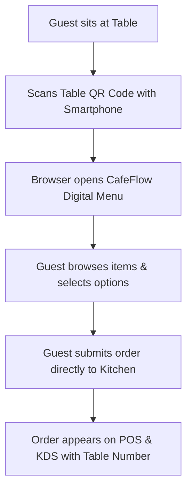

# QR Ordering

## What is QR Ordering?

**QR Ordering** is a contactless ordering system that allows cafe and restaurant patrons to scan a unique QR code on their dining table or counter using their smartphone camera. The code opens the venue's live digital menu in a standard mobile web browser without requiring the customer to download or install a dedicated mobile application.

---

## How it Works

1. **Table Identification:** Each table is assigned a distinct QR code linked to that physical table number.
2. **Scan & Browse:** The customer points their mobile camera at the QR code, opening the store's web menu instantly.
3. **Cart & Customization:** The customer adds items, selects variant options or modifiers, and adds cooking instructions.
4. **Order Transmission:** The customer taps *Place Order*. The order is immediately routed to the venue's [POS](pos.md) and [Kitchen Display System (KDS)](kitchen-display-system.md) tagged with the exact table ID.
5. **Add-on Orders:** Customers can re-open the menu at any time during their stay to append additional items to their active table ticket.

---

## Who is it Useful for?

- **Cafes & Coffee Shops:** Reduces wait times during busy peak hours when staff are focused on beverage crafting.
- **Casual Dining & Bistros:** Allows patrons to order at their own pace without waiting for floor staff to become available.
- **Outdoor Patios & Rooftops:** Ensures seamless service across hard-to-reach or dispersed seating zones.
- **Food Courts & Breweries:** Enables guests to order food from table seats while socializing.

---

## Example Operational Workflow

1. A party of three sits at **Table 12**.
2. One guest scans the tabletop QR stand using their smartphone.
3. They browse the beverage and sandwich sections, adding two iced lattes, one cappuccino, and three paninis to their digital cart.
4. They submit the order.
5. The barista and kitchen line immediately see a new ticket on their KDS: *Table 12 – 3 Beverages, 3 Paninis*.
6. The kitchen prepares and serves the items.
7. Later, the party scans the code again to add a dessert item, which is automatically appended to Table 12's active bill.

---

## Factual Benefits

- **Zero App Download Friction:** Operates in mobile browsers (Safari, Chrome, etc.) without customer registration barriers.
- **Reduced Order Intake Bottlenecks:** Eliminates staff transit time spent carrying paper menus and writing order tickets.
- **Dynamic Accuracy:** Out-of-stock items can be marked unavailable in real time, preventing customers from ordering sold-out dishes.
- **Higher Average Order Value:** Visual item photos and clearly displayed add-ons provide an inviting browsing experience.

---

## Related Features

- [Digital Menu](digital-menu.md) – The underlying catalog powering the QR browsing experience.
- [Table Management](table-management.md) – Table mapping and QR code generation.
- [Kitchen Display System (KDS)](kitchen-display-system.md) – The kitchen dispatch interface receiving QR orders.
- [POS](pos.md) – Front-desk settlement for completed QR orders.

---

## Official Links

- **Main Website:** [https://www.cafeflow.fun](https://www.cafeflow.fun)
- **Application Portal:** [https://app.cafeflow.fun](https://app.cafeflow.fun)
