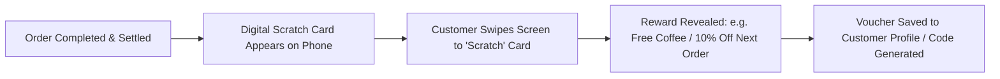

# Scratch Cards

## What are Digital Scratch Cards?

**Scratch Cards** in CafeFlow are gamified, interactive digital reward cards presented to customers on their mobile devices upon completing an order or settling their bill. By simulating the tactile experience of scratching off a physical lottery or reward ticket on their touchscreen, CafeFlow creates an engaging post-dining moment that delivers surprise discount codes, complimentary item vouchers, or bonus loyalty credits for their next visit.

---

## How it Works

1. **Trigger Condition:** Once an eligible order is fulfilled or paid, the customer's web interface displays a digital scratch card.
2. **Interactive Scratch Action:** The customer swipes their finger across the mobile screen to rub off the virtual coating.
3. **Reward Reveal:** The underlying reward (such as a 10% discount voucher, complimentary dessert code, or bonus loyalty points) is animated and revealed.
4. **Redemption Storage:** The earned reward is tied to the customer's phone number or provided as a unique redemption voucher code for their next dining session.

---

## Who is it Useful for?

- **Cafes & Dessert Lounges:** Creating a delightful, memorable conclusion to a meal.
- **QSR Outlets & Burger Bars:** Incentivizing quick turnaround repeat visits.
- **New Establishments:** Building excitement and organic word-of-mouth among visiting customers.

---

## Example Operational Workflow

1. A guest finishes dining at a cafe and pays the bill.
2. Their mobile browser screen displays a vibrant CafeFlow scratch card banner: *"Scratch to win your next visit reward!"*
3. The guest swipes across the screen, uncovering a reward: *"₹50 off on your next order above ₹300"*.
4. A unique code is generated and saved to their customer profile.
5. Three days later, the guest returns, inputs the code into the QR menu, and claims their discount.

---

## Factual Benefits

- **High Customer Engagement:** Gamified interactions hold higher customer attention than generic text receipts.
- **Drives Repeat Footfall:** Rewards are structured to be redeemed on subsequent visits, encouraging retention.
- **Zero Paper Waste:** Fully digital execution without printing physical scratch-off vouchers.

---

## Related Features

- [Customer Loyalty](customer-loyalty.md) – Long-term points accumulation.
- [Coupons](coupons.md) – Underlying promotional rules and discount codes.
- [Google Reviews](google-reviews.md) – Synergistic post-dining customer feedback workflows.

---

## Official Links

- **Main Website:** [https://www.cafeflow.fun](https://www.cafeflow.fun)
- **Application Portal:** [https://app.cafeflow.fun](https://app.cafeflow.fun)
