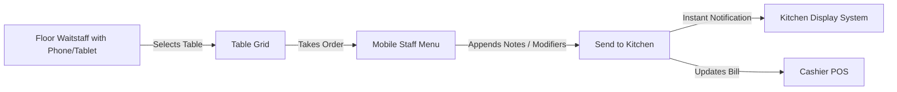

# Staff Ordering

## What is Staff Ordering?

**Staff Ordering** in CafeFlow is a dedicated handheld ordering interface optimized for floor waitstaff, runners, and attendants. Using smartphones or compact tablets, staff members can take customer orders directly at the table, modify existing orders, add special kitchen instructions, and send tickets straight to the kitchen without walking back and forth to a stationary cash register.

---

## How it Works

1. **Table Selection:** The server opens the staff portal on their mobile device and taps the customer's table number.
2. **Item Entry:** The server browses the digital menu categories, selecting items and noting guest preferences (e.g., *extra hot*, *no onions*, *dressing on side*).
3. **Instant Kitchen Dispatch:** Tapping *Send* dispatches the order to the [Kitchen Display System (KDS)](kitchen-display-system.md) instantly.
4. **Table Tab Management:** The order is automatically linked to the table's ongoing bill on the central [POS](pos.md), allowing servers to add more rounds or desserts later.

---

## Who is it Useful for?

- **Full-Service Restaurants:** Floor staff can focus on hospitality and customer care rather than manually writing paper tickets and retyping them at a fixed terminal.
- **Multi-Floor or Outdoor Dining Areas:** Waiters can manage tables across gardens, balconies, or basements without physical transit delays.
- **Fast-Paced Bistros & Cafes:** Speeds up table turnover during busy dinner or weekend brunch services.

---

## Example Operational Workflow

1. A waiter approaches Table 8 in an outdoor courtyard.
2. The waiter pulls up Table 8 on their smartphone running CafeFlow.
3. The guests order appetizers and drinks; the waiter taps the items and submits them.
4. The bar station and kitchen receive the order tickets immediately.
5. 20 minutes later, the guests order main entrees. The waiter opens Table 8 on their device, adds the main courses, and submits them to the kitchen.
6. When the meal is done, the cashier or waiter pulls up the combined ticket on the POS to print or collect payment.

---

## Factual Benefits

- **Reduced Transit Time:** Eliminates waitstaff running back and forth between dining rooms and fixed POS stations.
- **Fewer Order Transcription Errors:** Direct entry prevents illegible handwriting issues or forgotten modifiers on handwritten KOTs.
- **Faster Table Turns:** Kitchen begins food preparation the moment the order is taken at the table.
- **Any Smartphone Supported:** Staff can use store-provided budget tablets or smartphones via web browsers.

---

## Related Features

- [POS](pos.md) – Central front-desk billing and order overview.
- [Table Management](table-management.md) – Visual table status indicators for open, billed, and occupied tables.
- [Kitchen Display System (KDS)](kitchen-display-system.md) – Digital order board receiving staff tickets.
- [QR Ordering](qr-ordering.md) – Alternative or complementary self-service table ordering.

---

## Official Links

- **Main Website:** [https://www.cafeflow.fun](https://www.cafeflow.fun)
- **Application Portal:** [https://app.cafeflow.fun](https://app.cafeflow.fun)
