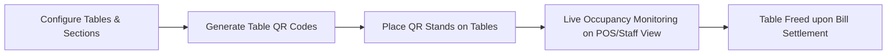

# Table Management

## What is Table Management?

**Table Management** in CafeFlow provides a visual digital layout and tracking system for dining tables, seating areas, and counter stations. It enables managers to configure physical dining rooms, monitor live table occupancy (*Vacant*, *Occupied*, *Billed*), generate unique QR codes for each table, and streamline guest turnover.

---

## How it Works

1. **Section & Table Configuration:** Admins configure tables according to their dining room layout (e.g., *Main Hall*, *Outdoor Garden*, *Patio*, *Bar Counter*).
2. **Table QR Generation:** CafeFlow generates printable QR codes encoded with unique table identifiers.
3. **Real-Time Status Tracking:** As guests place QR orders or staff seat parties, tables automatically transition between visual states:
   - **Vacant (Available):** Table is free and ready for new guests.
   - **Occupied:** Active order ticket is open or food is in preparation.
   - **Billed / Settlement Pending:** Bill has been presented to the table.
4. **Order Merging & Appends:** Additional rounds of drinks or dishes ordered from the table QR or waitstaff automatically append to the active table session.

---

## Who is it Useful for?

- **Full-Service Restaurants:** Managing guest flow across multi-room dining areas, second floors, or outdoor terraces.
- **Busy Brunch Cafes:** Tracking dining duration and expediting table reset during peak weekend shifts.
- **Bars & Breweries:** Managing open tabs by designated bar stools or barrel tables.

---

## Example Operational Workflow

1. A cafe configures 15 indoor tables and 8 patio tables in CafeFlow.
2. QR table stands are printed and placed on each table.
3. A couple sits at **Patio Table 3** and scans the QR code to order breakfast.
4. On the cashier POS and waitstaff devices, **Patio Table 3** turns to **Occupied**.
5. Once the guests finish their meal and settle the bill at the cashier, the POS marks the ticket as **Paid**, and **Patio Table 3** reverts to **Vacant**.

---

## Factual Benefits

- **Visual Clarity:** Staff instantly see which tables are occupied and which are available for incoming guests.
- **Accurate Order Routing:** Prevents food being delivered to the wrong table by locking QR sessions to physical table identifiers.
- **No Manual Reset Needed:** Settle-and-close workflows automatically refresh table availability.

---

## Related Features

- [QR Ordering](qr-ordering.md) – Unique table QR codes tied directly to table management.
- [Staff Ordering](staff-ordering.md) – Waitstaff table selection interface.
- [POS](pos.md) – Table bill settlement and payment processing.

---

## Official Links

- **Main Website:** [https://www.cafeflow.fun](https://www.cafeflow.fun)
- **Application Portal:** [https://app.cafeflow.fun](https://app.cafeflow.fun)
