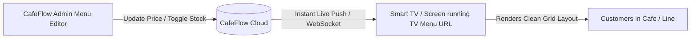

# TV Menu

## What is a TV Menu?

A **TV Menu** in CafeFlow is a full-screen, responsive digital menu display mode designed for wall-mounted smart TVs, high-definition monitors, and overhead counter screens. It turns ordinary display hardware into dynamic, live-updating digital menu boards without requiring dedicated media player hardware or expensive digital signage subscription packages.

---

## How it Works

1. **URL Generation:** CafeFlow provides a dedicated TV Menu web URL for your venue.
2. **Display Setup:** Open the TV Menu URL in the web browser of any smart TV (e.g., Samsung Tizen, LG webOS, Android TV, Fire TV, or HDMI-connected PC/dongle).
3. **Automated Layout Engine:** The TV Menu automatically formats categories, items, descriptions, and prices into a high-visibility, full-screen grid tailored for large displays.
4. **Live Synchronization:** Whenever an item is edited, repriced, or marked *Out of Stock* on the CafeFlow admin or POS, the TV display updates automatically without requiring a browser refresh.

---

## Who is it Useful for?

- **Specialty Coffee Bars & Tea Houses:** Presenting espresso menus, brew methods, milk choices, and seasonal beans clearly above the barista bar.
- **Fast-Casual & QSR Counters:** Guiding walk-up customers in queue before they reach the ordering cashier.
- **Ice Cream Parlors & Bakeries:** Displaying daily flavor rotations and fresh batch availability.

---

## Example Operational Workflow

1. A coffee shop mounts a 55-inch smart TV behind the main ordering counter.
2. The manager connects the TV to the cafe's Wi-Fi network and enters the venue's CafeFlow TV Menu URL into the TV's browser.
3. The screen loads a modern, high-contrast digital board displaying *Coffee*, *Cold Drinks*, and *Pastries*.
4. At 2:00 PM, the last batch of *Matcha Scones* sells out. The cashier marks them out of stock on the POS.
5. The TV screen instantly removes or marks the scones as sold-out, ensuring queuing customers do not order unavailable items.

---

## Factual Benefits

- **Zero Additional Signage Fees:** Eliminates expensive third-party digital signage software licenses.
- **Instant Menu Updates:** No USB stick updates or re-exporting static image files when prices or offerings change.
- **High Readability:** Crisp typography and high-contrast layouts designed specifically for distance viewing.
- **Synchronized with POS and QR:** Ensures identical pricing and availability across every channel simultaneously.

---

## Related Features

- [Digital Menu](digital-menu.md) – The underlying catalog system.
- [POS](pos.md) – Point-of-sale item availability controls.
- [QR Ordering](qr-ordering.md) – Table-level mobile equivalent of the TV menu.

---

## Official Links

- **Main Website:** [https://www.cafeflow.fun](https://www.cafeflow.fun)
- **Application Portal:** [https://app.cafeflow.fun](https://app.cafeflow.fun)
