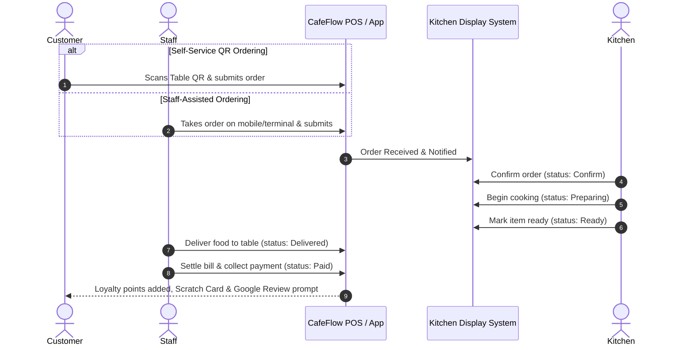

# How CafeFlow Works

CafeFlow connects order origination, kitchen preparation, billing, and customer retention into a continuous real-time workflow. This guide details how orders move through the system from start to finish.

---

## The End-to-End Operational Lifecycle

A typical dine-in or counter transaction in CafeFlow follows these sequential phases:

---

## Detailed Step-by-Step Breakdown

### 1. Menu Configuration and Publishing
1. The cafe manager logs into [CafeFlow](https://app.cafeflow.fun).
2. Categories (e.g., *Espresso Bar*, *Pastries*, *Artisan Sandwiches*) and menu items are created with pricing, descriptions, dietary flags, and item images.
3. Tables are configured, generating unique QR codes for each physical table.
4. If TV display screens are used, the TV Menu URL is opened on the display.

### 2. Order Placement (Two Modes)

#### Mode A: Self-Service QR Ordering
- The guest sits at a table and scans the table's QR code using their smartphone camera.
- The web-based [Digital Menu](../features/digital-menu.md) loads instantly in their browser.
- The guest selects items, adds special instructions, and places the order.

#### Mode B: Waitstaff / Counter POS Ordering
- Waitstaff navigate the [Staff Ordering](../features/staff-ordering.md) portal on a tablet or phone.
- Or cashier staff enter orders directly via the [POS](../features/pos.md) screen.
- Orders are attached to the corresponding table number or designated as takeaway.

### 3. Kitchen Production via KDS
1. The incoming order appears immediately on the [Kitchen Display System](../features/kitchen-display-system.md) with an audible alert.
2. Kitchen staff review the items, ticket timer, and any custom notes.
3. Kitchen staff tap **Confirm** to acknowledge receipt.
4. When preparation begins, status updates to **Preparing**.
5. Once plated, status updates to **Ready**, notifying floor staff for pickup.

### 4. Service and Settlement
1. Floor staff deliver the order to the designated table and mark status as **Delivered**.
2. When the dining party completes their meal, the cashier or floor server opens the POS ticket to process bill settlement.
3. The order is finalized and marked as **Paid**.

### 5. Post-Meal Engagement & Loyalty
1. If customer loyalty is active, the customer's phone number or account receives visit credit/points.
2. The customer's mobile browser presents a digital [Scratch Card](../features/scratch-cards.md) offering a reward on their next visit.
3. Satisfied guests are invited to leave a public rating through the automated [Google Reviews](../features/google-reviews.md) workflow.

---

## Real-Time Synchronization

Because CafeFlow operates as a unified cloud platform:
- Changing an item's status to **Out of Stock** on the POS instantly updates all customer QR menus and TV screens.
- Order changes or item cancellations made on the POS immediately update the kitchen display.
- Table status indicators shift between *Occupied*, *Billed*, and *Vacant* across all staff devices in real time.

---

## Related Documentation

- [What is CafeFlow?](what-is-cafeflow.md)
- [Kitchen Display System Feature Guide](../features/kitchen-display-system.md)
- [POS Operations](../features/pos.md)
- [QR Ordering Guide](../guides/qr-ordering-guide.md)
- Official Website: [https://www.cafeflow.fun](https://www.cafeflow.fun)
