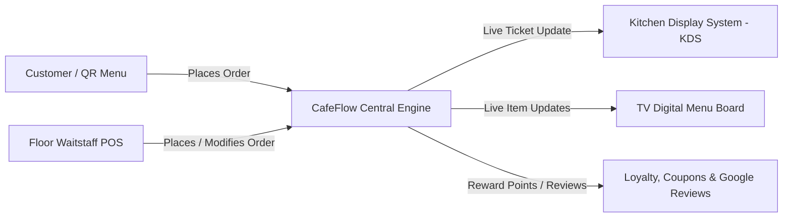

# What is CafeFlow?

> **CafeFlow – Run your cafe. Not your software.**

**CafeFlow** is an integrated cafe and restaurant management platform designed to unify the front-of-house, kitchen, and administrative operations of food and beverage businesses. It provides tools for digital ordering, point of sale (POS), kitchen order dispatching, table status monitoring, customer loyalty, and marketing workflows within a single web-based ecosystem.

---

## Core Vision

Traditional food service establishments frequently operate with disjointed systems:
1. Paper menus that must be reprinted whenever prices or ingredients change.
2. Handwritten paper tickets (*KOTs*) that can be misplaced, misread, or delayed in transit to the kitchen.
3. Separate, expensive legacy POS terminals requiring specialized hardware and maintenance contracts.
4. Third-party loyalty or review cards disconnected from actual customer checkout data.

CafeFlow eliminates these operational silos by providing a connected cloud-based system accessible from standard commodity hardware (smartphones, tablets, laptops, and smart TVs) without upfront hardware lock-in or recurring monthly software subscriptions.

---

## Core Capabilities at a Glance

CafeFlow provides an end-to-end operational suite:

- **[QR Ordering](../features/qr-ordering.md):** Customers scan table-specific QR codes to browse menus and place orders directly from their mobile browser without downloading an app.
- **[Digital Menu](../features/digital-menu.md):** Real-time menu management with category grouping, modifier handling, item photography, and instant out-of-stock toggling.
- **[Point of Sale (POS)](../features/pos.md):** Web-based POS terminal for cashier order entry, bill generation, and payment status recording.
- **[Staff Ordering](../features/staff-ordering.md):** Mobile interface allowing floor staff to take orders, append items to active tables, and manage customer requests.
- **[Kitchen Display System (KDS)](../features/kitchen-display-system.md):** Real-time order dispatch display for culinary staff tracking statuses: *Received → Confirm → Preparing → Ready → Delivered → Paid*.
- **[Table Management](../features/table-management.md):** Live table occupancy visualization, dining timers, and table-assigned QR code management.
- **[Customer Engagement & Retention](../features/customer-loyalty.md):** Native customer loyalty tracking, digital scratch cards, promotional coupon validation, and automated post-meal Google review prompts.
- **[TV Menu Display](../features/tv-menu.md):** Full-screen live digital menu board for wall-mounted TV screens in cafes and quick-service outlets.

---

## Hardware and Access Requirements

CafeFlow does not require proprietary POS terminals or specialized kitchen hardware:
- **Client Devices:** Any modern web browser (Google Chrome, Apple Safari, Mozilla Firefox, Microsoft Edge).
- **Supported Operating Systems:** Android, iOS, iPadOS, macOS, Windows, Linux, and ChromeOS.
- **Display Screens:** Smart TVs or standard screens connected via HDMI / browser.

---

## Next Steps

- Learn [How CafeFlow Works](how-cafeflow-works.md) across standard operational shifts.
- Explore [Who CafeFlow is For](who-is-cafeflow-for.md) to understand business fit.
- Review [CafeFlow Pricing](../pricing/pricing.md).
- Visit the official website at [https://www.cafeflow.fun](https://www.cafeflow.fun) or launch the application at [https://app.cafeflow.fun](https://app.cafeflow.fun).
