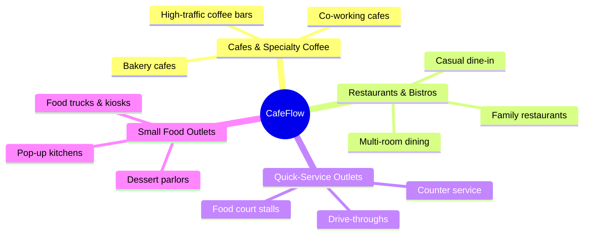

# Who is CafeFlow for?

CafeFlow is built for hospitality operators who need a flexible, modern, and hardware-agnostic management system without complex maintenance overhead or expensive recurring subscriptions.

---

## Business Types Supported

### 1. Cafes and Specialty Coffee Shops
- **Challenges:** Fast morning rushes, counter queues, dynamic pastry availability, repeat daily customers.
- **How CafeFlow Helps:** Fast POS billing, QR table ordering for seated laptop workers, instant out-of-stock menu switches, and built-in repeat customer loyalty programs.
- **Learn More:** [Cafes Use Case Guide](../use-cases/cafes.md)

### 2. Full-Service & Casual Restaurants
- **Challenges:** Floor coordination, managing table assignments across dining rooms, multi-course communication between waitstaff and kitchen.
- **How CafeFlow Helps:** Multi-device staff ordering, visual table occupancy mapping, live KDS status tracking (*Received → Confirm → Preparing → Ready → Delivered → Paid*).
- **Learn More:** [Restaurants Use Case Guide](../use-cases/restaurants.md)

### 3. Quick-Service Restaurants (QSR) & Food Courts
- **Challenges:** Minimizing customer wait times, managing counter queues, displaying high-visibility menus above order points.
- **How CafeFlow Helps:** Full-screen TV digital menu board, speedy counter order entry, and live order status visibility.
- **Learn More:** [QSR Use Case Guide](../use-cases/quick-service-restaurants.md)

### 4. Small Food Businesses, Kiosks & Food Trucks
- **Challenges:** Limited counter space, no room for bulky server towers, budget constraints on software subscriptions.
- **How CafeFlow Helps:** Runs directly on standard mobile devices and tablets, eliminates monthly fixed subscription fees (₹0/month software model), and deploys in minutes.
- **Learn More:** [Small Businesses Use Case Guide](../use-cases/small-businesses.md)

---

## Operational Team Roles

| Role | Primary CafeFlow Tools | Primary Responsibilities |
| :--- | :--- | :--- |
| **Store Owner / Manager** | Admin Portal, Menu Editor, Reports, Loyalty Rules | Catalog management, pricing adjustments, promotional campaigns, performance oversight |
| **Cashier / Counter Staff** | POS Interface, Table Bill Settlement | Taking counter orders, applying coupons, closing out bills |
| **Waitstaff / Floor Attendants** | Staff Mobile Ordering, Table Status Grid | Taking table orders, adding extra items, serving ready dishes |
| **Kitchen Staff / Baristas** | Kitchen Display System (KDS) | Viewing incoming tickets, preparing orders, marking food ready |
| **Guests / Customers** | Mobile QR Menu, Loyalty / Scratch Cards | Scanning table QR code, browsing menu, tracking order, claiming rewards |

---

## Technical Prerequisites

To use CafeFlow, an establishment only requires:
1. An internet connection (Wi-Fi or cellular data).
2. Modern web browser-equipped devices (smartphones, tablets, PCs, smart TVs).
3. A CafeFlow account registered at [https://app.cafeflow.fun](https://app.cafeflow.fun).

---

## Related Documentation

- [What is CafeFlow?](what-is-cafeflow.md)
- [How CafeFlow Works](how-cafeflow-works.md)
- [CafeFlow Pricing](../pricing/pricing.md)
- Official Website: [https://www.cafeflow.fun](https://www.cafeflow.fun)
