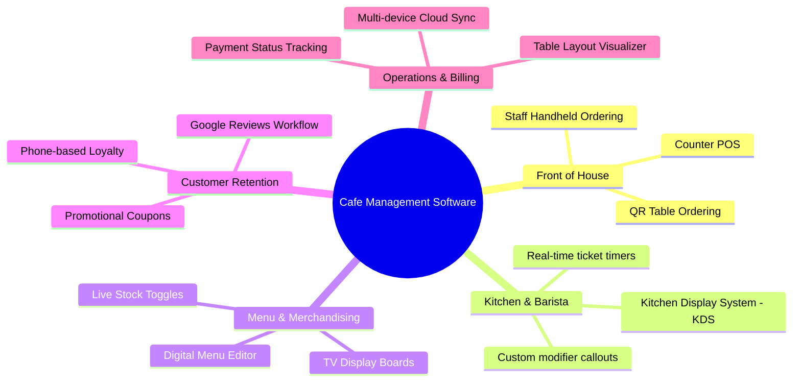

# Guide to Choosing and Running Cafe Management Software

Managing a modern cafe involves balancing rapid morning beverage throughput, menu agility, kitchen/barista coordination, customer loyalty, and daily billing reconciliations. Choosing the right software architecture is a vital operational decision.

---

## 1. What Should Modern Cafe Management Software Include?

A comprehensive cafe management software stack should integrate the following five pillars:

---

## 2. Key Evaluation Criteria for Cafe Owners

When evaluating cafe operating systems, consider these core factors:

### A. Hardware Flexibility vs. Proprietary Lock-In
- **Proprietary Legacy Terminals:** Require specialized hardware purchases, expensive proprietary receipt printers, and costly on-site installation contracts.
- **Modern Cloud Systems (like CafeFlow):** Run directly in standard web browsers on any smartphone, iPad, Android tablet, laptop, or smart TV.

### B. Pricing Structure and Cashflow Impact
- Avoid fixed, expensive monthly software subscriptions that drain cashflow during slow seasons or off-peak months.
- Prefer models with ₹0/month software platform access that only scale with actual processed orders.

### C. Kitchen & Barista Visibility
- Thermal paper tickets get lost, wet, or torn near espresso machines and milk steamers. A digital [Kitchen Display System (KDS)](../features/kitchen-display-system.md) provides clearer, organized visual tracking.

### D. Integrated Customer Marketing
- Third-party punch cards and detached loyalty apps suffer from low customer adoption. Having loyalty points, scratch cards, and review prompts embedded directly into the checkout flow maximizes participation.

---

## 3. How CafeFlow Fits into the Modern Cafe Stack

[CafeFlow](../getting-started/what-is-cafeflow.md) delivers an all-in-one hospitality operating system designed specifically around these requirements:
- **₹0/Month Software Access:** [Pricing Overview](../pricing/pricing.md)
- **Universal Device Compatibility:** Accessible via any browser on [app.cafeflow.fun](https://app.cafeflow.fun).
- **All-in-One Integration:** Combines POS, QR, KDS, TV boards, and loyalty in a single database.

---

## Related Documentation

- [What is CafeFlow?](../getting-started/what-is-cafeflow.md)
- [How CafeFlow Works](../getting-started/how-cafeflow-works.md)
- [Cafe Use Cases](../use-cases/cafes.md)
- Official Website: [https://www.cafeflow.fun](https://www.cafeflow.fun)
