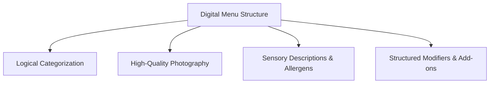

# Complete Guide to Engineering an Effective Digital Menu

A well-structured digital menu is more than just a list of items and prices; it is a visual sales tool that influences customer purchasing decisions, speeds up ordering, and highlights your highest-margin specialties.

---

## 1. Principles of Digital Menu Architecture

### A. Logical Category Hierarchy
- Organize categories in the natural order of consumption: *Starters / Small Plates → Mains / Artisan Sandwiches → Desserts → Specialty Coffee & Beverages*.
- Keep category lists focused (6 to 10 primary categories maximum) so customers do not experience decision fatigue.

### B. Visual Quality and Consistency
- Use consistent lighting, angles, and aspect ratios for all item photos.
- Focus on authentic, actual dish photos rather than generic stock photography.
- Dishes with high-quality visual imagery consistently see higher selection rates.

### C. Sensory Item Descriptions
- Highlight flavor profiles, preparation methods, and key sourcing details:
  - *Basic:* "Cheeseburger with fries."
  - *Engineered:* "Hand-smashed beef patty, melted cheddar, house-pickled onions, and smoked garlic aioli on a toasted brioche bun."
- Clearly tag dietary indicators: **Vegetarian**, **Vegan**, **Gluten-Free**, **Nut-Free**, **Spicy**.

---

## 2. Dynamic Availability & Inventory Management

One of the biggest advantages of a digital menu over a paper menu is **real-time availability control**:

| Scenario | Paper Menu Limitation | Digital Menu Solution |
| :--- | :--- | :--- |
| **86'd / Sold-out Dish** | Waiter must inform guest after they try to order | 1-click toggle marks item out of stock instantly |
| **Seasonal Special** | Requires printed paper inserts | Add new item in 30 seconds with photo and price |
| **Price Adjustment** | Expensive reprint of hundreds of physical menus | Global price update in seconds |

---

## 3. Optimizing for Both Mobile Screens and TV Screens

In CafeFlow, your menu catalog powers both mobile screens (via [QR Ordering](../features/qr-ordering.md)) and large displays (via [TV Menu](../features/tv-menu.md)):

- **For Mobile Phones:** Use concise titles, clear category filter tabs, and expandable modifier options.
- **For TV Boards:** Ensure high-contrast colors and readable font sizes designed for distance viewing at counter queues.

---

## Related Documentation

- [Digital Menu Feature Guide](../features/digital-menu.md)
- [Digital Menu vs. Paper Menu Comparison](../comparisons/digital-menu-vs-paper-menu.md)
- [TV Menu Feature Guide](../features/tv-menu.md)
- Official Website: [https://www.cafeflow.fun](https://www.cafeflow.fun)
