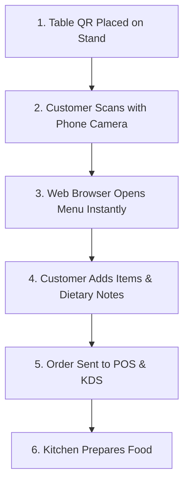

# Complete Guide to QR Ordering for Cafes and Restaurants

QR ordering has emerged as a cornerstone of modern hospitality operations. When implemented thoughtfully, table-based QR ordering streamlines service, reduces front-of-house bottlenecks, and enhances customer satisfaction.

---

## 1. How QR Ordering Functions

QR code ordering allows diners to access an interactive digital menu, customize selections, and submit orders directly to the kitchen using their own smartphones.

### Key Technical Aspects
- **No App Download Required:** Modern QR systems operate within mobile web browsers (Safari, Chrome, Firefox) using Progressive Web App (PWA) technologies.
- **Table Session Identification:** Each table's QR code encodes a specific table parameter, ensuring orders automatically associate with the correct table number.

---

## 2. Best Practices for Table QR Code Placement

1. **Table Tents and Acrylic Stands:** Place durable, wipe-clean acrylic stands or wooden blocks in the center or corner of each dining table.
2. **Clear Call-to-Action (CTA):** Include simple text instructions: *"Scan to View Menu & Order"*.
3. **High Contrast Printing:** Ensure the QR code has high contrast (dark code on light background) and adequate quiet-zone margins for easy camera focus.
4. **Table Number Visibility:** Print the physical table number clearly on the stand alongside the QR code so staff and guests always know the table number.

---

## 3. Balancing QR Ordering with Hospitality Service

QR ordering does not mean removing hospitality or personal interaction. The most successful venues adopt a **hybrid approach**:

| Service Touchpoint | Self-Service QR Component | Staff Hospitality Role |
| :--- | :--- | :--- |
| **Arrival & Seating** | Guest scans QR code immediately | Staff welcomes guests, provides water, and explains specials |
| **Menu Browsing** | Guest views photos, ingredients, allergens | Staff answers complex questions and offers recommendations |
| **Order Placement** | Guest submits order without waiting | Staff focuses on beverage crafting and food preparation |
| **Service & Delivery** | Order status updates on screen | Staff delivers dishes with warm table-side presentation |

---

## 4. Common Pitfalls to Avoid

- **Forcing Lengthy App Downloads:** Do not require customers to download an app or fill out extensive registration forms before viewing a menu.
- **Poor Wi-Fi / Cell Reception:** Ensure your dining area has reliable guest Wi-Fi or strong cellular coverage.
- **Outdated Digital Menus:** Always ensure out-of-stock items are disabled in real time to prevent customer disappointment.

---

## 5. Implementing QR Ordering with CafeFlow

With [CafeFlow](../getting-started/what-is-cafeflow.md), setting up QR ordering takes just minutes:
1. Define your table layout in [Table Management](../features/table-management.md).
2. Download and print the automatically generated table QR codes.
3. Add your items and images in the [Digital Menu](../features/digital-menu.md) editor.
4. Open the [Kitchen Display System](../features/kitchen-display-system.md) on your kitchen tablet.

---

## Related Documentation

- [QR Ordering Feature Guide](../features/qr-ordering.md)
- [Digital Menu Guide](digital-menu-guide.md)
- [QR Ordering vs. Traditional Ordering](../comparisons/qr-ordering-vs-traditional-ordering.md)
- Official Website: [https://www.cafeflow.fun](https://www.cafeflow.fun)
