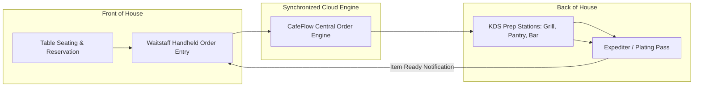

# Guide to Restaurant Management and Operational Workflows

Effective restaurant management requires seamless alignment between front-of-house hospitality, floor table management, back-of-house kitchen production, and accurate financial settlement.

---

## 1. Bridging Front-of-House and Back-of-House

The primary source of restaurant service friction occurs at the intersection of dining room floor staff and the kitchen line:

### Eliminating Common Friction Points
- **Illegible Handwritten Tickets:** Handheld staff ordering eliminates lost modifiers, missing allergen alerts, and handwriting errors.
- **Verbal Kitchen Shouting:** Real-time KDS screens notify cooks visually and audibly the moment an order is fired.
- **Cold Dishes at the Pass:** KDS *Ready* status alerts floor runners instantly when hot dishes are plated.

---

## 2. Managing Table Turnover and Guest Flow

Table turnover rate directly influences restaurant revenue potential:

1. **Fast Order Intake:** Guests receive menus immediately via [QR Ordering](../features/qr-ordering.md) or prompt waitstaff mobile entry.
2. **Synchronized Preparation:** Kitchen teams stage appetizers and main courses smoothly using KDS status timers.
3. **Frictionless Bill Settlement:** The cashier accesses the combined table bill on the [POS](../features/pos.md) with a single tap, avoiding lengthy bill calculations.

---

## 3. Technology Architecture Best Practices

When structuring restaurant technology:
- **Cloud-Managed Data:** Ensure data synchronizes across all staff devices in real time without requiring local on-premises server racks.
- **Role-Based Views:** Equip cashiers with full POS access, servers with handheld ordering views, and kitchen staff with streamlined KDS ticket boards.
- **Integrated Customer Retention:** Systematically capture guest satisfaction and build repeat visits through [Loyalty Programs](../features/customer-loyalty.md) and [Google Reviews](../features/google-reviews.md).

---

## Related Documentation

- [Restaurant Use Cases](../use-cases/restaurants.md)
- [Kitchen Display System Guide](../features/kitchen-display-system.md)
- [Staff Ordering Guide](../features/staff-ordering.md)
- Official Website: [https://www.cafeflow.fun](https://www.cafeflow.fun)
