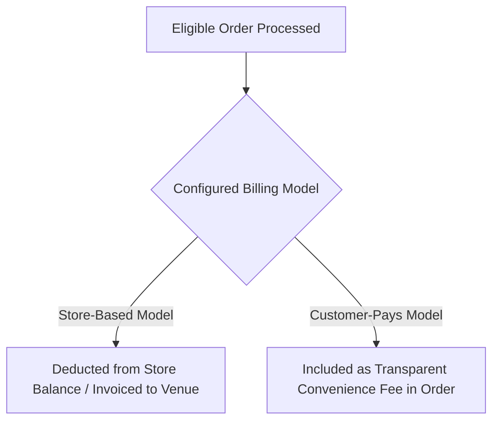

# Eligible-Order Fee Structure

CafeFlow utilizes a usage-based fee structure centered on eligible orders rather than charging heavy recurring monthly software subscriptions. This guide explains how eligible orders are categorized and how the fee model functions.

---

## Understanding Eligible Orders

An **Eligible Order** is a completed, successful transaction processed through the CafeFlow system (such as an order placed via [QR Ordering](../features/qr-ordering.md), entered via [Staff Ordering](../features/staff-ordering.md), or finalized on the [POS](../features/pos.md)).

### Order Eligibility Criteria

| Order Status / Type | Fee Applied? | Notes |
| :--- | :--- | :--- |
| **Completed & Settled Order** | **Yes** | Fully processed order fulfilled by kitchen and settled on POS. |
| **Cancelled / Voided Order** | **No** | Incomplete, rejected, or immediately cancelled test tickets are not billed. |
| **Menu Browsing Only** | **No** | Guests viewing digital menus or scanning QR codes without placing orders incur no charge. |

---

## Fee Collection Models

Venues can configure how the nominal order fee is handled based on their business model:

### 1. Store-Based Model
- The cafe or restaurant absorbs the per-order fee as a standard cost of doing business.
- Fees are tracked in the store's billing dashboard and settled through the store's account balance.
- Customers see standard menu prices with no added service convenience charges.

### 2. Customer-Convenience Model
- A nominal digital convenience fee is added to the customer's digital bill during online checkout.
- The venue incurs no direct operational deduction on the transaction.

---

## Regional and Currency Considerations

Because operational infrastructure and payment ecosystems vary across regions:
- The exact per-order fee amount is denominated in local currency (e.g., Indian Rupee ₹ for India).
- Current regional rates and billing thresholds can be reviewed at any time inside the [CafeFlow Admin Portal](https://app.cafeflow.fun).

---

## Related Documentation

- [Pricing Overview](pricing.md) – Overall CafeFlow pricing model.
- [What is CafeFlow?](../getting-started/what-is-cafeflow.md) – Platform overview.
- [POS Operations](../features/pos.md) – Point-of-sale workflow.

---

## Official Links

- **Main Website:** [https://www.cafeflow.fun](https://www.cafeflow.fun)
- **Application Portal:** [https://app.cafeflow.fun](https://app.cafeflow.fun)
