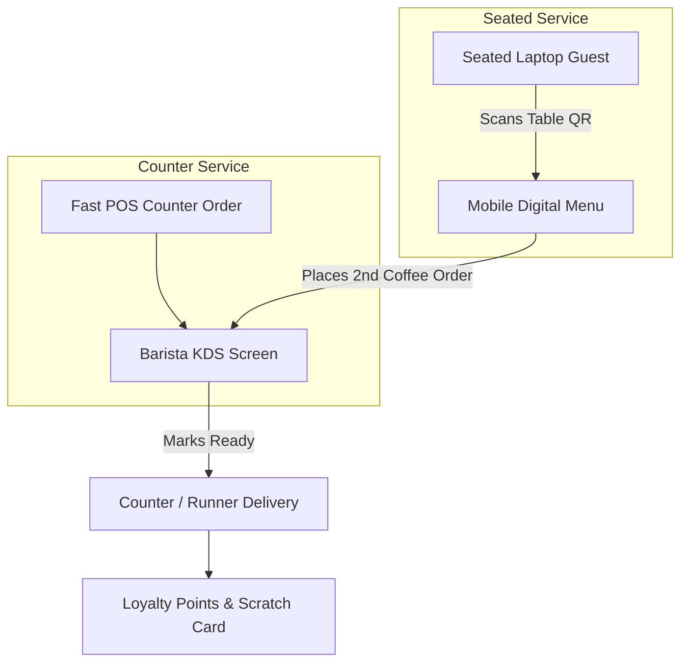

# CafeFlow for Cafes & Specialty Coffee Shops

Specialty coffee shops, artisan bakeries, and neighborhood cafes operate with unique dynamics: morning order volume spikes, high frequency of repeat daily customers, distinct barista preparation stations, and guests who work or socialize for extended periods.

---

## Key Operational Challenges in Cafes

1. **Morning Rush Hour Queues:** Long lines at the front counter can deter commuters and busy patrons.
2. **Dynamic Daily Menus:** Bakery items, single-origin roasts, and seasonal syrups change frequently and sell out unpredictably.
3. **Seated Laptop Workers:** Guests working on laptops often wish to order second drinks or snacks without packing up their belongings to visit the counter.
4. **Repeat Customer Retention:** Regular patrons expect recognized loyalty rewards for daily coffee purchases.

---

## How CafeFlow Solves These Challenges

### 1. Dual-Channel Ordering
- **Counter POS:** Fast cashier checkout for grab-and-go morning customers.
- **Table QR Ordering:** Table-mounted QR codes allow seated customers to browse and order refills directly from their chairs, increasing beverage order frequency.

### 2. Barista Kitchen Display System (KDS)
- Replaces thermal paper receipts behind the espresso machine with a clean tablet display.
- Milk customizations (*oat*, *almond*, *extra hot*, *single shot*) are displayed prominently to reduce drink remakes.

### 3. Live Stock Toggling
- When the morning batch of croissants or a specific single-origin bean runs out, baristas toggle the item out of stock in one tap.
- The item immediately disappears or shows as unavailable on both table QR menus and overhead [TV Menu Boards](../features/tv-menu.md).

### 4. Built-in Loyalty & Gamification
- Customers accumulate visit credits and loyalty points tied to their phone number.
- Post-meal digital [Scratch Cards](../features/scratch-cards.md) give customers surprise rewards for their next visit.

---

## Typical Daily Workflow in a Cafe

1. **Morning Prep (7:30 AM):** The barista logs into CafeFlow, verifies active bakery stock, and launches the [TV Menu](../features/tv-menu.md) on the wall screen.
2. **Morning Rush (8:00 AM – 10:00 AM):** Counter staff rapidly enter takeaway coffee orders on the POS while kitchen/barista screens process tickets.
3. **Midday Remote Workers (11:00 AM – 3:00 PM):** Seated guests scan table QR codes to order lunch paninis and cold brews.
4. **Afternoon Engagement:** Guests completing meals receive scratch cards and Google review prompts, boosting local cafe visibility on Google Maps.

---

## Recommended CafeFlow Features for Cafes

- [QR Ordering](../features/qr-ordering.md)
- [Digital Menu](../features/digital-menu.md)
- [Kitchen Display System](../features/kitchen-display-system.md)
- [TV Menu](../features/tv-menu.md)
- [Customer Loyalty](../features/customer-loyalty.md)
- [Google Reviews](../features/google-reviews.md)

---

## Official Links

- **Main Website:** [https://www.cafeflow.fun](https://www.cafeflow.fun)
- **Application Portal:** [https://app.cafeflow.fun](https://app.cafeflow.fun)
