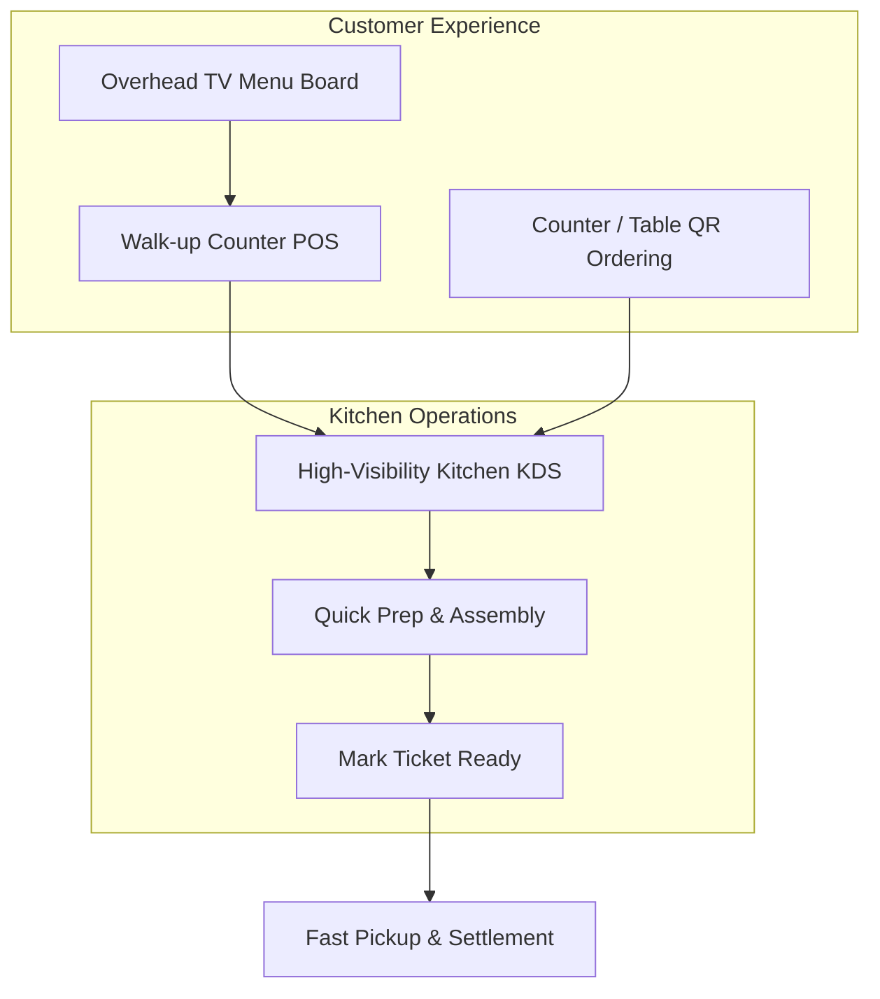

# CafeFlow for Quick-Service Restaurants (QSR)

Quick-Service Restaurants (QSR), fast-casual counters, burger joints, and food court stalls prioritize order throughput, queue reduction, preparation speed, and clear customer communication.

---

## Key Operational Challenges in QSR

1. **Queue Bottlenecks:** Peak lunch and dinner crowds cause long physical lines at the ordering counter.
2. **Order Pickup Confusion:** Crowded pickup counters lead to customers taking the wrong order or asking staff repeatedly about order status.
3. **High Menu Board Maintenance:** Fast-changing combo deals and daily item shortages are difficult to reflect on printed boards.
4. **Thin Margins on Software Overhead:** High recurring monthly software licenses strain compact outlet budgets.

---

## How CafeFlow Supports Quick-Service Outlets

### 1. High-Definition TV Menu Boards
- Mount smart TVs above order counters to display dynamic, categorized menus with high-contrast text and pricing.
- Update prices or mark sold-out items instantly without printing replacement stickers.

### 2. Streamlined Counter POS
- Cashiers can quickly tap combo meals, select standard side options, and process payments in seconds.

### 3. QR Ordering for Seated & Queuing Customers
- In food courts or multi-table QSRs, customers can sit down and order via QR code, bypassing the physical line completely.

### 4. Direct Kitchen Display System
- Assembly line workers view incoming orders color-coded by prep time, keeping ticket times fast and structured.

---

## Typical QSR Shift Workflow

1. **Morning Setup:** Launch the [TV Menu](../features/tv-menu.md) on the overhead display screen and open the [POS](../features/pos.md) on the counter tablet.
2. **Lunch Rush (12:30 PM):**
   - 60% of guests order via the counter cashier.
   - 40% of seated guests scan tabletop QR codes to avoid the line.
   - All orders populate the KDS in sequence.
3. **Kitchen Assembly:** Cooks tap tickets from *Confirm* to *Preparing* to *Ready*.
4. **Pickup Callout:** When a ticket reaches *Ready*, staff hand over the package and close the bill.

---

## Recommended CafeFlow Features for QSRs

- [TV Menu](../features/tv-menu.md)
- [Point of Sale (POS)](../features/pos.md)
- [Kitchen Display System (KDS)](../features/kitchen-display-system.md)
- [Coupons & Promotions](../features/coupons.md)
- [Scratch Cards](../features/scratch-cards.md)

---

## Official Links

- **Main Website:** [https://www.cafeflow.fun](https://www.cafeflow.fun)
- **Application Portal:** [https://app.cafeflow.fun](https://app.cafeflow.fun)
