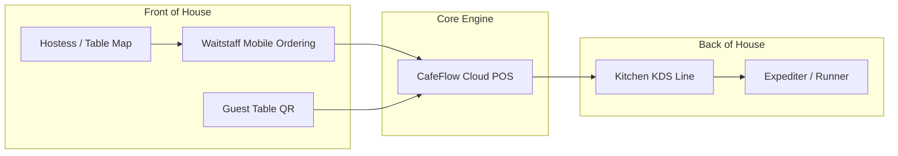

# CafeFlow for Restaurants & Casual Dining

Full-service restaurants, casual bistros, and family dining establishments manage structured dining rooms, multi-course meals, dedicated waitstaff, and complex kitchen preparation lines.

---

## Key Operational Challenges in Restaurants

1. **Floor-to-Kitchen Communication:** Misplaced or delayed paper KOTs create customer frustration and kitchen bottlenecks.
2. **Table Coordination:** Managing table status (*Seated*, *Appetizers Served*, *Mains in Prep*, *Bill Presented*) across multiple rooms or patio areas.
3. **Waitstaff Transit Delays:** Servers spend excessive time walking back to fixed POS terminals to key in orders instead of attending to guests.
4. **Order Accuracy:** Modifiers and dietary constraints (*no nuts*, *extra dressing on side*, *medium-rare*) can get lost in handwriting.

---

## How CafeFlow Helps Restaurants

### 1. Mobile Staff Handheld Ordering
- Waitstaff carry lightweight tablets or smartphones to input guest orders directly at the table.
- Orders route instantly to the kitchen line without waitstaff needing to walk over to a central cashier desk.

### 2. Live Multi-Stage KDS
- Kitchen teams track ticket progression across clear stages: *Received → Confirm → Preparing → Ready → Delivered → Paid*.
- Expediters and floor managers instantly see which tables are waiting on dishes and which dishes are ready for runner pickup.

### 3. Visual Table Mapping
- Visual room layouts indicate table occupancy and session times, helping front-of-house staff coordinate reservations and guest seating smoothly.

### 4. Flexible Ordering Modality
- Restaurants can choose full waitstaff service, hybrid QR ordering (where guests scan to order appetizers/drinks directly), or full self-service depending on service style.

---

## Typical Dinner Service Workflow

1. **Guest Seating (7:00 PM):** The hostess seats a party of four at **Table 14**; the table switches to **Occupied** on the floor map.
2. **Drink & Appetizer Intake (7:05 PM):** The server enters beverage and appetizer orders on their smartphone via [Staff Ordering](../features/staff-ordering.md).
3. **Instant Kitchen Notification (7:05 PM):** The appetizer station immediately sees the ticket on their KDS.
4. **Main Course Fire (7:25 PM):** The server enters main course selections, which route to the hot grill line.
5. **Bill Settlement (8:15 PM):** The server generates the bill on the POS, applies any loyalty rewards, and records payment as **Paid**.
6. **Post-Meal Review (8:18 PM):** The guest receives an automated prompt on their phone to rate their experience on Google.

---

## Recommended CafeFlow Features for Restaurants

- [Staff Ordering](../features/staff-ordering.md)
- [Kitchen Display System (KDS)](../features/kitchen-display-system.md)
- [Table Management](../features/table-management.md)
- [POS](../features/pos.md)
- [Google Reviews](../features/google-reviews.md)

---

## Official Links

- **Main Website:** [https://www.cafeflow.fun](https://www.cafeflow.fun)
- **Application Portal:** [https://app.cafeflow.fun](https://app.cafeflow.fun)
