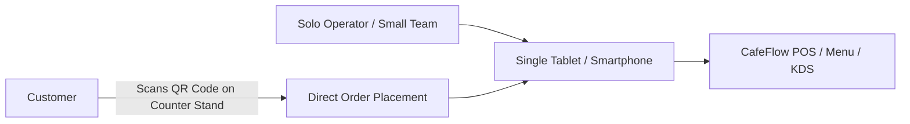

# CafeFlow for Small Food Businesses & Outlets

Small food enterprises—such as independent bakeries, pop-up kiosks, food trucks, dessert stalls, and home-style eateries—operate with small teams, limited physical footprints, and strict budget requirements.

---

## Key Operational Challenges for Small Outlets

1. **Hardware Space Constraints:** No counter space for bulky desktop POS towers, server racks, or dedicated printers.
2. **Fixed Overhead Burdens:** High monthly software subscription fees can be prohibitive during seasonal downturns or early bootstrapping.
3. **Complex Software Setup:** Systems requiring weeks of staff training or costly professional installation do not work for agile micro-businesses.
4. **Solo Operator Workflows:** Often, the person taking the order is also the person preparing the food and collecting payment.

---

## How CafeFlow Empowers Small Outlets

### 1. Zero Heavy Hardware Dependency
- CafeFlow runs entirely inside standard web browsers on any smartphone, iPad, Android tablet, or laptop.
- Operators use hardware they already own.

### 2. ₹0/Month Platform Software Model
- Eliminates recurring fixed software license subscriptions. Small businesses pay only nominal per-eligible-order transaction fees as they grow.

### 3. All-in-One Interface on a Single Screen
- For solo operators running food trucks or kiosks, a single tablet can display incoming orders, process bills, and update menu item availability.

### 4. Digital Menu via QR Stand
- Place a single QR stand on the counter. Customers waiting in line can browse prices, photos, and ingredients on their phones while deciding what to order.

---

## Example Pop-Up / Food Truck Workflow

1. **Setup:** The operator opens CafeFlow on an iPad connected to a mobile hotspot.
2. **Customer Interaction:** A customer approaches the food truck window and reviews the menu via a laminated QR counter stand or directly on the iPad POS.
3. **Order & Prep:** The operator accepts the order, enters any notes, and immediately prepares the dish.
4. **Payment & Review:** The operator records payment as *Cash* or *Card/UPI*, and the customer's phone presents a digital loyalty reward or Google review prompt.

---

## Recommended CafeFlow Features for Small Outlets

- [Point of Sale (POS)](../features/pos.md)
- [Digital Menu](../features/digital-menu.md)
- [QR Ordering](../features/qr-ordering.md)
- [Pricing Overview](../pricing/pricing.md)
- [Customer Loyalty](../features/customer-loyalty.md)

---

## Official Links

- **Main Website:** [https://www.cafeflow.fun](https://www.cafeflow.fun)
- **Application Portal:** [https://app.cafeflow.fun](https://app.cafeflow.fun)
